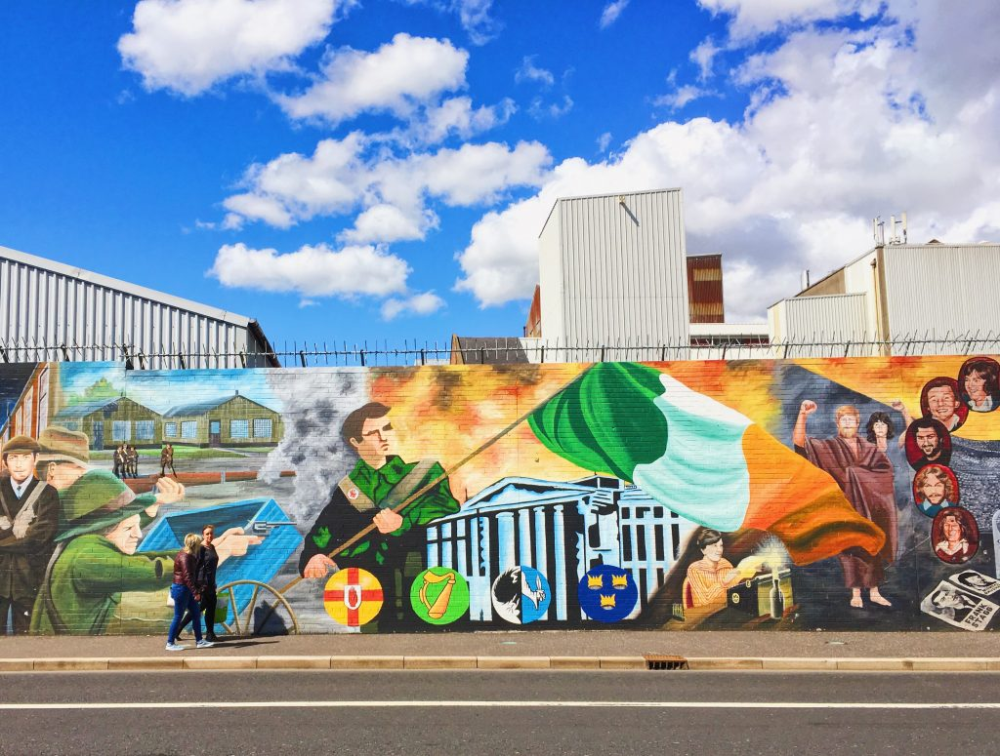
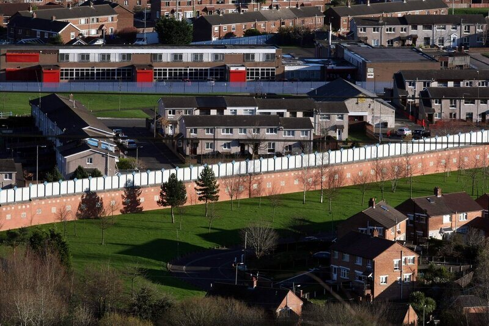
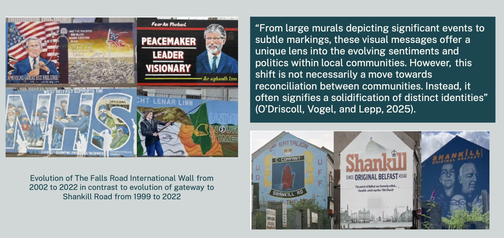
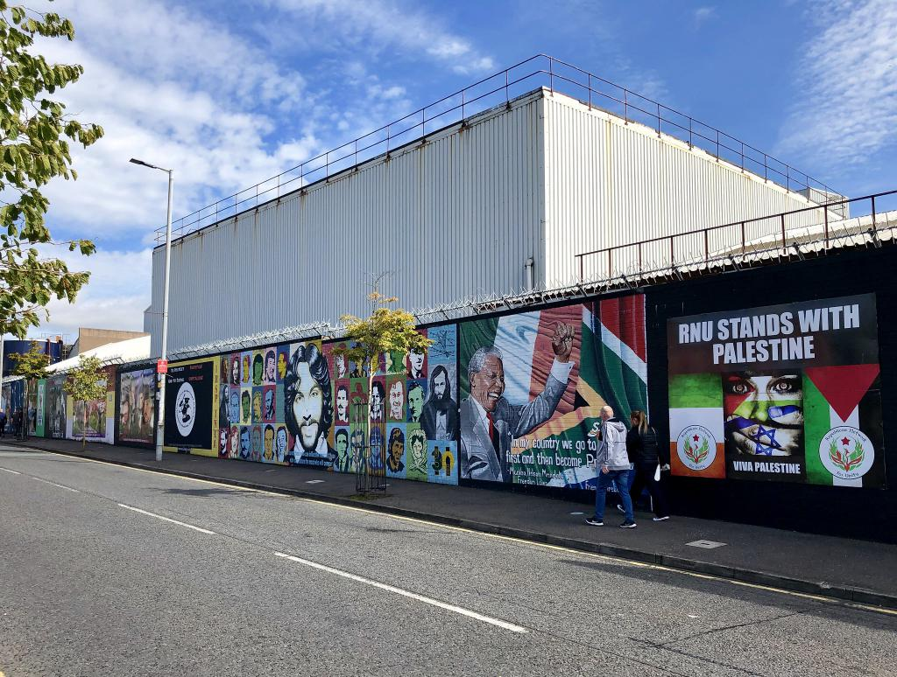



## Mapping Conflict Visualization in Belfast and Beyond

What does it truly mean for a conflict to be over? Just because there is an absence of physical violence or a formal government cessation of violence, does not mean that violence, then, is no longer felt in the day to day lives of those living in the aftermaths of a conflict. 

This is the question that I examine through my map, “Mapping Conflict Visualization in Belfast and Beyond.” 

My map examines Belfast, Northern Ireland with particular attention to the visual rhetoric of its peacewalls to show how conflict is not just political, it is something that is seen, lived, and actively mapped onto the spaces that it occurs within. Built environments are not passive. But rather the structures like walls, checkpoints, and barriers that make up these spaces are “symbols of violence threat and inequality”[^1]. This symbiotic relationship between space and conflict is particularly potent in Belfast, where the peace walls that formerly functioned as necessary barriers between loyalist and republican communities engaged in sectarian violence still stand as sites of physical reminders of division and simultaneously spaces of public expression through murals and urban graffiti that represent the identity, memory and power of respective communities and shape how people still experience structural division daily. 

[^1]: Kothari, U. (2006). Spatial practices and imaginaries: Experiences of colonial officers and development professionals. Singapore Journal of Tropical Geography, 27(3), 235–253. https://doi.org/10.1111/j.1467-9493.2006.00260.x

This idea, then, connects Belfast to other post conflict cities across the world that struggle with these same ideas of cultural violence. I specifically chose to examine this connection to Belfast in Berlin, Cyprus, the Gaza strip, and two other major Northern Irish cities– Derry/Londonderry and Portadown. 

What makes Belfast unique and what made it stand out to me as a place worth analyzing and mapping is the continued presence of peacewalls even almost 30 years after the end of formal conflict. In cities like Berlin, tearing down the walls that formerly divided communities was viewed as a necessary step towards promoting lasting peace. Why then was this not a priority in Belfast? One potential answer to this question is that the walls have taken on new meanings. No longer do they serve simply as physical barriers, they are now important sites of artistic expression that need to be protected. 

## Muralism as a means of expression

Murals simultaneously reflect and shape the political situation (Cook, 2018). Place is not a static concept, but rather changes over time in accordance with the communities that produce and reproduce it. Place is “both the product of relations of power and the material through which such relations are culturally articulated, challenged, and reproduced” (Artextaga, 24). In Belfast, this is seen through the different murals that have occupied the same spots on peacewalls over time based on changing community attitudes, which I examine on my map. As the city has navigated reconciling with life in the aftermath of the troubles, murals have become a means through which “representations of peace and conflict coexist in public space” (Migeon 2024).

Two prominent examples of this on my map, one from a nationalist perspective and one from a loyalist perspective, are the tracking of the Falls Road International Wall Mural and Gateway to Shankill Road narrative shifts. In 2002, the Falls Road International Wall was made up of Anti-war messaging in response to the U.S. presence in Afghanistan. More recently in 2022, the wall exhibits strong republican ideologies calling for a United Ireland and featuring Bobby Sands. In 1999, the Gateway to Shankill Road honored Loyalist paramilitary groups with depictions of weapons and loyalist imagery. In 2022, the mural claims Shankill as “original Belfast” with a crown replacing the dot of the “i” in Shankill and shifts towards imagery of community celebration. 

In both cases, mural narratives have tended to shift away from violent imagery in favor of community identification. In this sense, division is still created but through ideological markers rather than physical expressions of violence. Engaging in this sort of mural change tracking over time, we can better understand how communities express themselves, maintain their identities, and navigate the complex path of post-conflict evolution. 

## Shadows of division

Beyond muralism practice, my map aims to visualize the effects that the continued presence of walls that serve as a reminder of a time of physical violence has on the communities they exist within. Throughout Belfast, the peacewalls that still stand, “play both positive and negative roles in controlling access, use of space, and in creating a sense of security and belonging – or insecurity and exclusion – in the urban environment” (McAtackney 2011, 78). 

On my map, this idea is best exemplified through the largest peacewall still standing in Belfast, Wall 20 on the map, running along Cupar Way in West Belfast, dividing the Falls and Shankill roads. The streets between these two main roads used to be a mixed community of occupants of both religious communities until frequent attacks began to happen in this mixed zone and the government erected a wall to separate these communities in 1969. 

## Competing community attitudes and moving forward

My map can not show the lived experiences of the people of Belfast who even in a city considered to be “post-conflict” or in active peace-process, still grapple with cultural violence and segregation in their day to day lives. 

Peacewalls no longer serve as necessary means through which violence is prevented, yet still these walls remain standing and their gates continue to close at night, serving as a symbolic reminder of the city's recent history. To some, this is a necessary reminder, as people talk “quite often [about] how ‘fragile the peace is.” (Cohen 2024). But to others, these walls make true community reintegration, coexistence, and peace impossible. 

In Belfast, peace walls don’t just separate communities, they reinforce structural sectarian violence and division. People living closer to these walls have skewed experiences of division in their day to day lives and feel the continuous effects of sectarian division to a higher magnitude than those who live farther from said walls simply because their immediate environment is full of symbols and images that tell the history of conflict and express the current political climate.

On my map, the controversy that surrounds this idea of walls reinforcing structural violence is shown through the walls I kept on my map even though they have now been partially removed, fully demolished, or repurposed. Wall 14, for example, which used to run along the Crumlin Road in West Belfast, was partially removed in 2016  as a part of a community integration and landscape restoration project. This then serves as an example of how Belfast’s conflict visualization landscape is actively changing as community attitudes towards the peacewalls continue to shift. 

Since my map aims to balance community attitudes, it also includes a number of walls that continue to stand today due to the positive role they play in community engagement and expression. One point on my map, the “International Solidarity Wall,” on the Falls side of the main peacewall, is one such example of a wall that communities wish to protect rather than tear down. 

Ultimately, even as murals shift toward peace and community themes, the continued presence of the walls means that division is still, and will continue to be, a physical and visual shadow over the city. 

